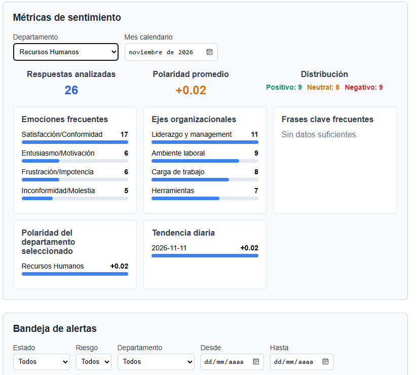
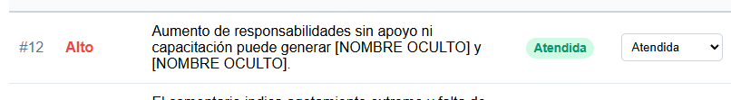

# Bitácora del ensayo de demo — 11 de noviembre de 2026

## Identificación y versión probada

| Dato | Registro |
| --- | --- |
| Fecha del ensayo y del registro | 11 de noviembre de 2026 |
| Zona horaria de referencia | America/Los_Angeles (UTC−08:00 en esta fecha) |
| Hora de inicio y finalización | No registrada; no se deduce de la hora del commit |
| Responsable de la ejecución manual | Julio Alfonso Monteverde Esquer |
| Elaboración de esta bitácora | Con asistencia de Codex a partir de salidas, capturas y confirmaciones compartidas por el responsable |
| Proyecto | Plurione — Análisis Sentimental Organizacional |
| Commit probado | `a9b1cd52a986ba4bd57a3601098fd15e29dac262` |
| Mensaje del commit | `Limpia de codigo y soluciones` |
| Fecha del commit | `2026-11-11T09:30:50-08:00` |
| Cambios locales al iniciar | `git status --short` sin salida en la transcripción compartida |
| Procedimiento de referencia | [README: recorrido manual para la evaluación](../README.md#recorrido-manual-para-la-evaluación) |
| Proyecto de Docker Compose | `plurione-demo` |

Esta bitácora y sus evidencias se agregan después de la prueba. El commit identifica el código de la aplicación utilizado en el ensayo; todavía no incluye este documento. La elaboración de la bitácora no constituye una nueva ejecución autónoma del sistema.

## Objetivo y alcance

Comprobar el arranque de la versión actual, ejecutar las verificaciones técnicas indicadas en el README y repetir el caso del buzón en el que anteriormente permanecía visible un nombre después del cargo o tratamiento «jefa». Registrar también las métricas y el estado de alerta mostrados durante el recorrido.

El responsable reportó **cinco envíos del caso del nombre después del cargo y ocultación correcta en los cinco (5/5)**. Son repeticiones del caso descrito debajo, no cinco nombres distintos ni una medición general de precisión de la sanitización. Se distinguen los resultados respaldados por evidencia de los pasos del README que aún necesitan confirmación.

## Entorno y preparación

| Elemento | Evidencia del ensayo |
| --- | --- |
| Sistema y terminal | Windows, PowerShell; versión de Windows no proporcionada |
| Directorio del proyecto | `D:\plurione_AnalisisSentimentalOrganizacional` |
| Docker | `29.7.2`, build `a7dcaa6` |
| Docker Compose | `v5.5.1` |
| Backend | Imagen construida desde `python:3.12-slim` |
| Base de datos | `postgres:15-alpine` |
| Frontend | `node:20-alpine`; build con Vite `8.3.5` |
| URLs de referencia | Frontend: `http://localhost:5173/`; API: `http://localhost:8000/docs` |
| Puertos publicados | PostgreSQL: `127.0.0.1:5433`; frontend: `0.0.0.0:5173` y `[::]:5173`; API: `0.0.0.0:8000` y `[::]:8000` |

Se detuvo la instalación habitual con `docker compose down`. En el proyecto de demo se ejecutó `docker compose -p plurione-demo down -v`, que eliminó sus contenedores, red y volúmenes, incluidos los datos de la demo anterior. Después se ejecutó `docker compose -p plurione-demo up --build -d`.

La salida posterior de `docker compose -p plurione-demo ps` mostró `db`, `web` y `frontend` activos, con PostgreSQL en estado **healthy**. La preparación y las verificaciones siguientes están conservadas en la [transcripción de consola](evidencias_demo_2026-11-11/preparacion_y_pruebas.txt). No se adjuntan archivos `.env`, contraseñas, tokens ni llaves.

## Verificaciones técnicas ejecutadas

| Verificación | Resultado observado |
| --- | --- |
| `docker compose -p plurione-demo exec frontend npm run lint` | Sin errores reportados |
| `docker compose -p plurione-demo exec frontend npm run build` | Build completado; 84 módulos, 356 ms; JavaScript de 331.12 kB, 106.42 kB con gzip |
| `docker compose -p plurione-demo exec web pip check` | `No broken requirements found.`; aviso no bloqueante de caché de pip |
| `docker compose -p plurione-demo exec web python -X pycache_prefix=/tmp/plurione-pycache -m compileall -q app` | Regresó al prompt sin errores reportados |
| Suite de pruebas de Python | 55 casos, cada uno con resultado `ok`; resumen `Ran 55 tests in 0.844s` |

La suite se invocó con este comando:

```powershell
docker compose -p plurione-demo run --rm --no-deps -v "${PWD}:/workspace:ro" -w /workspace web python -m unittest -v test_api_hardening test_ai_engine_validation test_sanitization_regression test_feedback_response test_privacy test_mvp_acceptance test_csv_import test_alerts test_email_service test_model_evaluation
```

La copia compartida termina en `Ran 55 tests in 0.844s`: no incluye la línea final global `OK` ni el código de salida. Los 55 resultados individuales son correctos en la evidencia disponible; queda pendiente conservar el cierre global o el código de salida si se requiere acreditar formalmente la ejecución completa. Las pruebas con simulaciones no acreditan por sí solas la entrega real de correo, la respuesta real de Azure ni el recorrido manual con todas las cuentas.

## Prueba del buzón: nombre después del cargo

Se utilizó el caso sintético indicado en el README:

```text
PRUEBA DEMO ACTUAL: Mi jefa Ana López me humilla en las juntas. Mi correo es demo@example.test y mi telefono 6621234567.
```

El texto observado en la consulta de registros almacenados fue:

```text
PRUEBA DEMO ACTUAL: Mi jefa [NOMBRE OCULTO] me humilla en las juntas. Mi correo es [CORREO OCULTO] y mi telefono [TELEFONO OCULTO].
```

| Comprobación | Resultado |
| --- | --- |
| Nombre posterior al cargo «jefa» | Oculto en los cinco envíos reportados por el responsable: **5/5** |
| Correo del caso sintético | Sustituido por `[CORREO OCULTO]` en todos los registros compartidos |
| Teléfono del caso sintético | Sustituido por `[TELEFONO OCULTO]` en todos los registros compartidos |
| Conservación del sentido del comentario | Se mantienen «Mi jefa», «me humilla en las juntas» y el resto de la estructura del caso |
| Almacenamiento del texto sanitizado | Comprobado mediante la consulta compartida de la base de datos |

**Conciliación del número de registros:** el responsable identifica cinco envíos para esta comprobación, mientras que la salida pegada de la consulta contiene **seis registros**, todos con los tres datos ocultos. No se identifica cuál corresponde a un envío adicional; no se asigna artificialmente ninguno de los seis al lote de cinco. La evidencia permite registrar 5/5 según el responsable y seis filas sanitizadas en la consulta, conservando esa diferencia.

Los identificadores de la consulta son:

- `11577631-654d-412a-87f1-55b1c3b46567`
- `4c1e6291-be4c-4d77-a5df-c6642b5f6223`
- `0d2f7de1-f09c-4ad1-bbb4-f7683948d15d`
- `e4c4a82e-6a7e-4ed3-aa6b-7cfd1140df54`
- `b5e02d50-cde8-4f7c-95a6-af7ca8c4f29a`
- `fbecc25e-02df-456c-8c9a-baa1eabd9d7f`

Se conserva el texto de las seis filas en [registros de sanitización](evidencias_demo_2026-11-11/sanitizacion_registros.txt). Esta evidencia demuestra el resultado de almacenamiento del caso probado; no identifica el estado individual de análisis de IA de cada fila ni garantiza ocultación de todos los nombres posibles.

## Métricas observadas en el panel

La captura compartida muestra los filtros **Recursos Humanos** y **noviembre de 2026**:

| Indicador | Valor visible |
| --- | --- |
| Respuestas analizadas | 26 |
| Polaridad promedio | `+0.02` |
| Distribución | Positivo: 9; Neutral: 8; Negativo: 9 |
| Emociones frecuentes | Satisfacción/Conformidad: 17; Entusiasmo/Motivación: 6; Frustración/Impotencia: 6; Inconformidad/Molestia: 5 |
| Ejes organizacionales | Liderazgo y management: 11; Ambiente laboral: 9; Carga de trabajo: 8; Herramientas: 7 |
| Frases clave frecuentes | `Sin datos suficientes.` |
| Polaridad del departamento seleccionado | Recursos Humanos: `+0.02` |
| Tendencia diaria | `2026-11-11`: `+0.02` |

La distribución suma 26 y coincide con el total mostrado. Las emociones y los ejes admiten varias etiquetas por comentario, por lo que sus conteos no tienen que sumar 26. El mensaje sobre frases clave es compatible con la supresión por mínimo de privacidad; sin una consulta de frecuencias no se atribuye una causa concreta.

La captura no permite deducir el número total de filas importadas, el resumen final del CSV ni si el panel se actualizó automáticamente sin recargar. Tampoco identifica la cuenta o el rol utilizado.



## Alerta observada

La segunda captura muestra la alerta **#12**, riesgo **Alto**, con etiqueta y selector en estado **Atendida**. Su motivo visible es:

> Aumento de responsabilidades sin apoyo ni capacitación puede generar [NOMBRE OCULTO] y [NOMBRE OCULTO].

Queda confirmado el estado mostrado en ese momento. No se adjuntó evidencia del estado previo, de las transiciones intermedias ni de la persistencia después de recargar.

**Observación de claridad:** las dos sustituciones reducen la información del motivo. Se debe comparar el motivo original sintético con el sanitizado para determinar si eran nombres que debían ocultarse o términos ordinarios detectados incorrectamente. Con esta captura no se confirma un falso positivo. Esta observación se registra por separado del caso «Mi jefa Ana López», cuya ocultación sí quedó comprobada.



## Incidencias y avisos encontrados

| Incidencia o aviso | Interpretación y estado |
| --- | --- |
| Intento de ejecutar la carpeta como comando de PowerShell | Error de navegación corregido al usar `cd`; no es un fallo de la aplicación |
| `docker compose -p plurione-demo ps -v` | Opción no válida para `ps`; se continuó con `down -v` para reiniciar los datos del entorno de demo |
| Aviso de permisos de `/nonexistent/.cache/pip` | Caché deshabilitada; `pip check` concluyó sin dependencias rotas |
| Mensajes de contraseña inválida y `Error en pipeline IA dual (tipo=ValueError)` en la suite | Corresponden a escenarios negativos deliberados; los casos asociados terminan en `ok` |
| Motivo de la alerta con dos fragmentos ocultos | Observación de claridad pendiente de contrastar con el original sintético |

En el caso repetido del buzón no se observó el fallo anterior de conservar visible el nombre después del cargo. No se registraron otros fallos de aplicación en las evidencias compartidas; esto no equivale a una auditoría exhaustiva de seguridad o a ausencia general de errores.

## Cobertura del recorrido del README

| Punto | Estado de este ensayo |
| --- | --- |
| Identificar commit y cambios locales | Confirmado: commit registrado y árbol limpio al iniciar |
| Preparar demo y arrancar los tres servicios | Confirmado; PostgreSQL healthy |
| Lint, build, dependencias y compilación Python | Ejecutados sin errores bloqueantes reportados |
| Pruebas automatizadas | 55 resultados individuales `ok`; cierre global/código de salida no incluido en la copia |
| Repetición del error de nombre después del cargo | Confirmado para el caso: 5/5 según el responsable; seis filas sanitizadas conservadas como evidencia |
| Ocultación de correo y teléfono | Confirmada en las filas compartidas |
| Métricas, filtro de departamento y mes | Confirmados en la captura: RH, noviembre de 2026, 26 analizados |
| Existencia de alerta de riesgo Alto y estado Atendida | Confirmada para la alerta #12 |
| Transiciones de alerta y persistencia tras recargar | Pendientes de evidencia específica |
| Creación e inicio de sesión con cada uno de los cuatro roles | Sin confirmación individual en este ensayo; no se trasladan resultados de demos anteriores |
| Permisos de cada rol y rechazos HTTP 403 | Pendientes de comprobación manual documentada; hay cobertura automatizada de algunos permisos |
| Archivo CSV, filas procesadas, omitidas y fallidas | Pendiente de registrar nombre del archivo y resumen final de esta ejecución |
| Actualización de métricas y alertas al finalizar el CSV sin recargar | Pendiente de confirmación explícita |
| Rechazos manuales de RFC ambiguo, texto corto y solo números | Pendientes de documentar; las pruebas automatizadas no sustituyen el recorrido manual |
| Límite de inicio de sesión y respuesta HTTP 429 | Pendiente de prueba manual documentada |
| Azure real | Se muestran 26 respuestas contabilizadas como analizadas; no se adjuntó traza del proveedor ni aviso individual de los envíos del buzón |
| SMTP y entrega real de correo | No comprobados en esta evidencia; la prueba automatizada de correo no acredita entrega |
| Accuracy, recall y latencia con al menos 200 casos etiquetados | No medidos en este ensayo; requieren la evaluación cuantitativa separada |

## Resultado y seguimiento

**Ensayo realizado con evidencia de arranque, verificaciones técnicas, sanitización del caso del buzón y visualización del panel y de una alerta. El error del nombre después del cargo quedó superado en los cinco envíos reportados (5/5).** Los seis registros consultados también muestran el nombre, correo y teléfono ocultos.

El recorrido completo del README permanece pendiente de cierre por los puntos sin evidencia de la tabla anterior. Para completarlo:

1. Registrar el archivo CSV y su resumen final, y confirmar si el panel se actualiza sin recargar.
2. Documentar los accesos y restricciones de cada rol, las transiciones de alerta y su persistencia tras recargar.
3. Conservar las respuestas de los casos de rechazo, la prueba del límite de inicio de sesión y, si se prueba, la entrega real del correo.
4. Comparar el motivo original sintético de la alerta #12 con el texto sanitizado para resolver la observación de claridad.
5. Conservar el cierre global o el código de salida de la suite y ejecutar por separado la evaluación cuantitativa del modelo si se desean acreditar sus umbrales.

Las capturas y transcripciones de esta carpeta se registran como evidencia recibida el 11 de noviembre de 2026. No se dispone de hora individual de captura ni de hashes de origen previos a su incorporación. No se atribuyen a esta versión resultados de informes o bitácoras retirados.

## Referencia posterior: evaluación cuantitativa

Después de este ensayo manual se ejecutó, a solicitud del responsable, la [evaluación cuantitativa del modelo del 11 de noviembre de 2026](evaluacion_modelo_2026-11-11.md) sobre el mismo commit: 87% de accuracy, 100% de recall, 100% de cobertura y p95 de 2.1595 s en 200 casos. Esa corrida independiente queda documentada con su JSON y registro; no completa por sí sola los pasos manuales pendientes ni cambia lo observado en este ensayo.

## Repetición automatizada y visual para regenerar informes

El 11 de noviembre, entre las 10:20 y 10:29 de America/Los_Angeles, Codex ejecutó una comprobación nueva del mismo código en la base aislada `plurione_qa_20261111_35c1878b`. Esta sección amplía la evidencia con una ejecución distinta en QA. La tabla de cobertura anterior registra exclusivamente lo compartido durante el ensayo manual del autor.

| Comprobación posterior | Resultado nuevo |
| --- | --- |
| Pruebas automatizadas | 55 correctas, cierre `OK`, código de salida 0 |
| Integración con PostgreSQL y Azure reales | 76 PASS, 0 FAIL |
| Navegador: admin, hr, analyst y executive | Inicio/cierre de sesión comprobados; métricas para todos; bandeja y CSV visibles para admin/hr/analyst y ausentes para executive |
| Permisos API | 403 de executive para alertas y CSV, confirmados en integración |
| Alerta de QA #2 | Cambiada a Atendida desde la interfaz y conservada al recargar; es otra alerta distinta de la #12 del ensayo manual |
| CSV de interfaz | Una carga con 1 fila procesada, 1 omitida y 0 fallidas |
| Actualización del panel | RH/noviembre pasó de **7 a 8 análisis sin recargar** al terminar el CSV; promedio +0.73 |
| Aviso de límite | Seis intentos inválidos de login; aviso de espera visible y 429 en el log de la API QA |
| Limpieza | Dos contenedores y base temporales retirados; demo original activa y sin cambios en sus conteos durante las comprobaciones adversas |

El [informe funcional nuevo](pruebas_sistema_2026-11-11.md) describe cada recorrido. La [evaluación completa](evaluacion_completa_2026-11-11.md) registra los problemas encontrados fuera del caso del nombre: evasión con separadores invisibles, ocultación de expresiones comunes, NUL que produce 500 y riesgos de arquitectura. No se verificó entrega SMTP real ni se resolvió mediante esta prueba el motivo original de la alerta #12.
